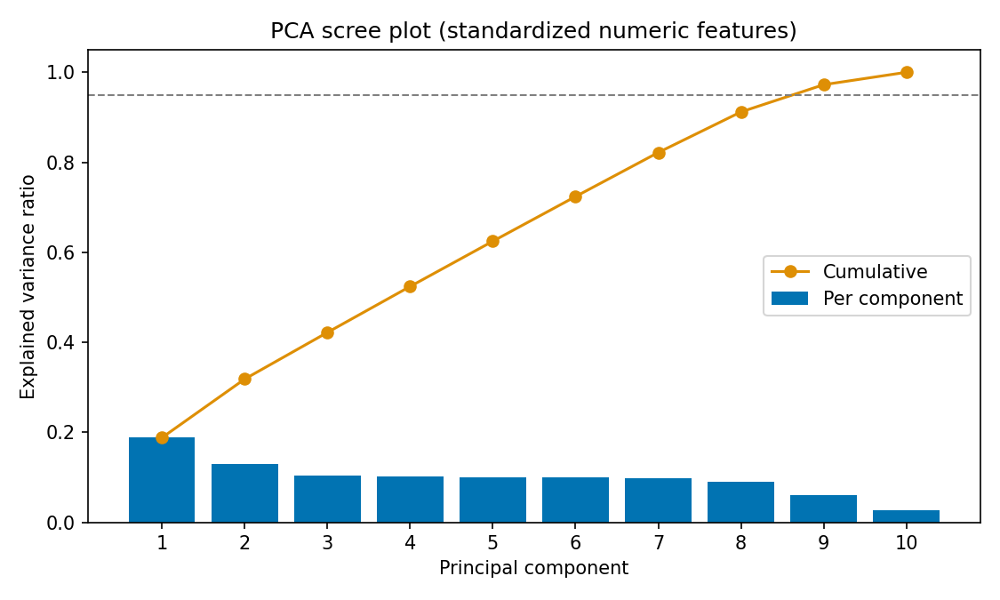
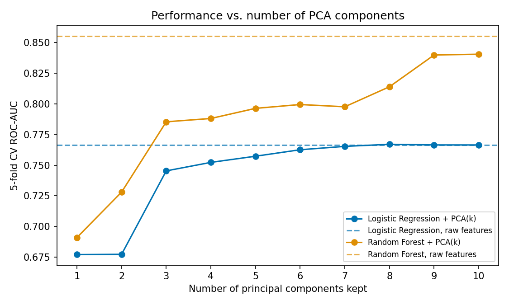

# Bank Customer Churn — SQL + ML + Explainable Dashboard

A data science project on the Kaggle **Bank Customer Churn**
dataset: relational SQL modeling → EDA → feature engineering → ML →
SHAP explainability → a Streamlit dashboard.

## 1. Business background

Customer churn is one of the most expensive problems in retail banking.
Acquiring a new customer typically costs far more than retaining an
existing one. Retention teams have limited time and budget, so knowing
which and why customers are likely to leave helps them focus outreach
on the accounts that are both at risk and worth keeping.

This project builds that pipeline on 10,000 bank customers across
France, Germany, and Spain, of whom **20.4% churned**.

## 2. Dataset

[Bank Customer Churn (Kaggle)](https://www.kaggle.com/datasets/radheshyamkollipara/bank-customer-churn) —
10,000 rows, 18 columns: demographics, account info, and churn/engagement
signals.

**Data leakage found during EDA:** `Complain` is a nearly perfect proxy for
the target (correlation = 0.996). A complaint is almost certainly logged
around the time a customer decides to leave, so a model trained on it
would only "predict" churn after it's essentially already happened.
`Complain` is deliberately excluded from the feature set, see
`src/features.py`.

## 3. ETL: CSV → normalized SQLite database

The CSV is split into three related tables to mirror how this would
actually be stored operationally, and to justify writing real SQL joins:

```
customers -- demographic/profile info (customer_id PK)
accounts -- product & balance info (customer_id FK)
churn_status -- churn label + complaint flag (customer_id FK)
```

Built with `src/02_build_database.py` → `data/processed/bank_churn.db`.

## 4. SQL analysis (`/sql`)

| File | Demonstrates | Key finding |
|---|---|---|
| `01_churn_rate_by_segment.sql` | `GROUP BY` + aggregates | Germany churns at ~32% vs ~16% for France/Spain |
| `02_full_customer_view.sql` | Multi-table `JOIN` | The analysis-ready view used by every downstream step |
| `03_window_functions.sql` | `RANK`, `NTILE`, moving average, cumulative rate | Balance rank per country, tenure quartiles |
| `04_high_value_high_risk.sql` | `CASE WHEN` + CTEs | High-value/high-risk customers churn at 26.4%, 3.4x standard-value/lower-risk (7.9%) |

Sharpest signal in the dataset: customers holding **3-4 products churn
at 83-100%**, vs 7.6% for customers with 2 products. This points to a product-bundling or service-quality problem

## 5. EDA (`src/03_eda.py` → `reports/figs/`)

- Overall churn rate at 20.4%. Because the classes are imbalanced, accuracy
alone is a misleading metric for modeling.
- Churn rises with age into the 50s, then falls.
- Inactive members churn substantially more than active ones.

## 6. Feature engineering (`src/features.py`)

- `Complain` and ID columns excluded (see §2).
- Encoding/scaling done inside the modeling pipeline, fit only on
  the training fold, to avoid leaking test-set statistics.
- Two engineered features: `balance_salary_ratio` (idle balance relative
to income) and `products_activity_score` (products multiplied by the
active-member flag). An inactive customer holding multiple products is
a distinct, high-risk profile, as shown in §4.

## 7. Modeling (`src/04_modeling.py`)

Logistic Regression → Random Forest → XGBoost → LightGBM, 5-fold
stratified cross-validation, plus an XGBoost+SMOTE variant. Recall is
prioritized over precision: missing a churner costs more than an
unnecessary retention call.

| Model | CV ROC-AUC | Test Precision | Test Recall | Test F1 | Test ROC-AUC |
|---|---|---|---|---|---|
| **Random Forest** | 0.856 | 0.555 | **0.730** | 0.631 | **0.876** |
| LightGBM | 0.851 | 0.549 | 0.713 | 0.621 | 0.870 |
| XGBoost + SMOTE | — | **0.722** | 0.522 | 0.606 | 0.868 |
| XGBoost | 0.852 | 0.518 | 0.733 | 0.607 | 0.866 |
| Logistic Regression | 0.767 | 0.382 | 0.723 | 0.500 | 0.779 |

**Random Forest** was selected: best ROC-AUC and best recall among the
balanced models.

### 7.1 PCA: redundancy check and ablation (`src/06_pca_analysis.py`)

To test whether the numeric features are redundant, and whether dimensionality
reduction helps, PCA was applied to the 10 continuous/count features
(standardized, fit on the training split only; binary flags and one-hot
categoricals passed through).

- **Little redundancy.** Apart from engineered ratios correlating with their
  source columns (|r| ≈ 0.5) and a genuine balance–products relationship
  (r = −0.31), features are close to uncorrelated. 9 of 10 components are
  needed to retain 95% of the variance.
- **PCA did not help.**

| Model | Numeric block | CV ROC-AUC | Test ROC-AUC |
|---|---|---|---|
| Logistic Regression | raw | 0.7665 | 0.7792 |
| Logistic Regression | PCA (9 comps) | 0.7665 | 0.7799 |
| Random Forest | raw | 0.8550 | 0.8772 |
| Random Forest | PCA (9 comps) | 0.8397 | 0.8638 |
| XGBoost | raw | 0.8521 | 0.8662 |
| XGBoost | PCA (9 comps) | 0.8399 | 0.8516 |

- **Why.** With an L2 penalty, logistic regression is invariant to rotations
  of its inputs (with all 10 components its CV ROC-AUC is identical to the
  raw baseline). Tree models split on single original features, so rotating
  the axes hurts them even when no component is dropped (Random Forest:
  0.840 with all 10 components vs 0.855 raw). Components are also linear
  mixtures, which would make SHAP explanations unreadable.

Raw features were therefore kept in the final model.

<p align="center">
  
  
</p>

## 8. Model interpretability — SHAP (`src/05_shap_analysis.py`)

Global feature importance confirms the SQL/EDA findings quantitatively —
age, number of products, product-activity interaction, and being in
Germany are the top churn drivers.

Individual SHAP waterfalls (`reports/figs/`) show why a specific
customer is flagged. The highest-risk test customer (92% predicted
probability, correctly flagged as churned) is pushed up mainly by
holding 4 products, being 46, being in Germany, and being inactive.

## 9. Dashboard (`dashboard/app.py`, Streamlit)

Two tabs: **Overview** (portfolio-level churn stats and the
high-value/high-risk segment table from §4) and **Predict Churn Risk**
(enter a customer's details, get a live probability + SHAP waterfall).

```bash
pip install -r requirements.txt
streamlit run dashboard/app.py
```

## 10. Business recommendations

1. **Investigate the 3-4 product bundle experience** — the single
   highest-leverage finding in this dataset.
2. **Prioritize German and inactive multi-relationship customers** for
   retention outreach.
3. **Re-engage inactive single-product members** before they become
   high-value flight risks.
4. **Use the dashboard's per-customer explanation, not just the score**,
   when deciding what retention offer actually makes sense.

## Repo structure

```
data/
raw/ -- original Kaggle CSV
processed/ -- SQLite db, train/test splits
sql/ -- 4 .sql files, see §4
src/
01_explore_data.py
02_build_database.py
run_sql.py
03_eda.py
features.py
04_modeling.py
05_shap_analysis.py
dashboard/
app.py
reports/
figs/ -- all PNGs referenced above
model_comparison.csv
models/
best_model.joblib -- full sklearn Pipeline (preprocessing + classifier)
requirements.txt
```

### Reproducing the pipeline end to end

```bash
python src/02_build_database.py
python src/03_eda.py
python src/04_modeling.py
python src/05_shap_analysis.py
streamlit run dashboard/app.py
```